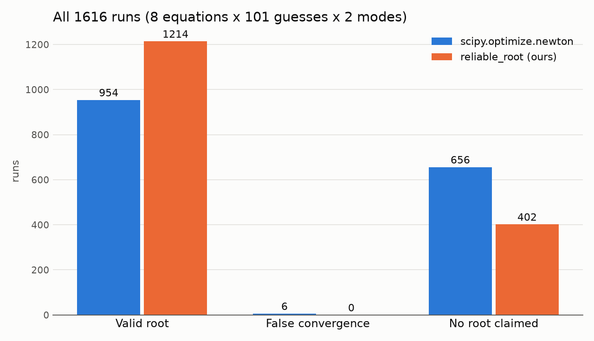

# Improving SciPy Root-Finding Reliability

CSCI 3656 group project: Sutchin, Austin, Stryder

## The problem

SciPy's `newton()` can say it found a root when it didn't ([issue #6379](https://github.com/scipy/scipy/issues/6379)):

```text
f(x) = x^4 - x^2 + 1,  x0 = 0.001
root = 0.001,  f(root) = 1.0,  converged = True
```

This function never reaches zero, so there is no root. SciPy stops because its steps got tiny, not
because `f(x)` got close to 0.

## Our fix

`reliable_root()` runs SciPy, then checks the answer. If the check fails, it tries Brent's method,
a safer method that always works once `f` changes sign. If there's no root to find, it says so.

```python
from improved_root import reliable_root

rep = reliable_root(f, x0)
print(rep)          # full report
if rep.reliable:
    print(rep.root)
```

## Results

1616 test runs (8 equations, 101 starting guesses, with and without the derivative):

| | SciPy | Ours |
|---|---:|---:|
| Correct roots | 954 | **1214** |
| Wrong answers marked "converged" | 6 | **0** |



## Files

| File | Who | What |
|---|---|---|
| `original_problem.py` | Everyone | Shows the bug |
| `improved_root.py` | Sutchin | The tool |
| `benchmark.py` | Austin | Tests and charts |
| `demo.ipynb` | Stryder | Step-by-step walkthrough |
| `presentation.pdf` | Everyone | Slides |

## Run it

```bash
pip install -r requirements.txt
python original_problem.py
python improved_root.py
python benchmark.py
```

## Limits

- Costs a few extra function calls.
- Can't find roots that touch zero without crossing it, like `(x-1)^2`.
- Very steep roots, like `cbrt(x)`, need a looser tolerance (`ftol`).
